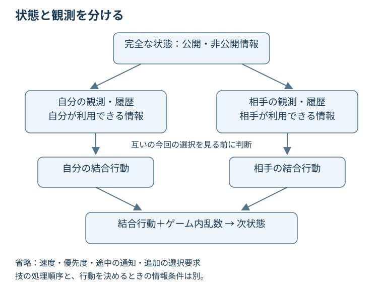

# 第5章　対戦を数学の言葉で表す

> **この章の結論**　シミュレーターの完全な状態と、プレイヤーが判断に使える情報は違います。さらに、相手の方策を固定するか、相手も変化する主体として扱うかで、解くべき問題が変わります。

**学習目標**：状態・観測・履歴を区別する／ダブルの行動を結合行動として表す／固定相手への最適化とゲームを区別する／観測から隠れた情報の確率を更新する。

**前提と読み方**：条件付き確率と期待値は既知とします。人工知能（Artificial Intelligence：AI）の実装コードは扱いません。定義・手計算・問題を含む1レッスンとして設計しています。第1〜4章は「何を測るか」、ここからは「何を解いているか」を学びます。

## 5.1 同じ画面なら、同じ問題なのか

自分と相手の残り体力、天候、場にいるポケモンが同じ二つの局面を考えます。片方では相手が直前に特定の技を使い、もう片方では使っていません。画面の要約が同じでも、過去に公開された技や行動順から得られる情報は違い得ます。その違いは、次の選択の価値を変えます。

ここで三つを分けます。**状態**はゲームの今後の確率的な進行を定めるために必要な情報、**観測**はそのうちプレイヤーに与えられる情報、**履歴**はそのプレイヤーがこれまで受け取った観測と選んだ行動の記録です。「状態」という名前の入力テンソルを使っている論文でも、その中身が実際には観測の要約である場合があります。名前ではなく、含まれる情報を確認します。

ターン番号を非負整数$t$、完全な状態を$s_t$、自分の観測を$o_t$、自分の行動を$a_t$、相手の行動を$b_t$とします。これらは特定サイズのベクトルとは限らず、ゲーム上の対象です。プレイヤーにとっての履歴は、簡略化すると

$$h_t=(o_0,a_0,o_1,a_1,\ldots,o_t)$$

と書けます。過去の相手行動が公開されるなら、次の観測に含めます。実際にはどのログ・公開項目が入力に入るかを明示する必要があります。

@fig-turn-information は、判断と状態遷移を分ける模式図です。**両者が行動を選ぶことと、技が処理される順序は別**です。ゲーム内で速度順に処理されても、後から動く側が相手の今回の選択を自由に見て選べるとは限りません。

{#fig-turn-information}

図では速度・優先度・途中のメッセージなどを省いています。各ターンの判断が一度で済む局面を想定しており、交代先の再指定などを含む実シミュレーターの全プロトコルを表すものではありません。

## 5.2 まずは一人の意思決定として考える

**マルコフ決定過程（Markov Decision Process：MDP）**は、現在の状態と行動から次状態の分布が決まる、一人の意思決定のモデルです。状態空間を$\mathcal S$、行動集合を$\mathcal A(s)$、遷移確率を$T(s'\mid s,a)$、期待即時報酬を$r(s,a)$とします。$s'$は次の状態を表します。ここで「マルコフ」とは、次の分布を決めるうえで、それ以前の履歴を現在状態に加えて参照する必要がないという仮定です。

$$\Pr(s_{t+1}=s'\mid h_t,s_t,a_t)=T(s'\mid s_t,a_t).$$

$\Pr$は確率です。右辺の$T$は固定された遷移モデルであり、確率は非負、次状態全体への和は1です。完全なゲーム状態を十分に含めればマルコフにできても、体力だけに圧縮した入力がマルコフとは限りません。状態の設計と、ネットワークへの入力設計を同一視しないでください。[1]

### 固定相手はどこへ行くのか

二人の遷移を$T(s'\mid s,a,b)$とし、相手が状態$s$で行動$b$を選ぶ固定方策を$\rho(b\mid s)$とします。状態・行動が有限の説明例なら、相手の選択を平均した自分用の遷移は

$$T_\rho(s'\mid s,a)=\sum_b\rho(b\mid s)T(s'\mid s,a,b)$$

です。$\sum_b$は相手の合法行動についての総和です。「相手が存在しない」のではなく、**固定された相手を環境の一部に組み込んだ**のです。

この式は相手方策を現在状態だけで表せる仮定を置いています。相手が過去の履歴や内部メモリに依存するなら、それを含む拡張状態を考えるなどの対応が必要です。相手の学習が進んで$\rho$が変われば、$T_\rho$も変わります。固定環境での結果を、あらゆる相手に対する保証へ拡張できない理由です。

| 見方 | 固定するもの | 学ぶ対象 |
|---|---|---|
| 固定相手への最適化 | 相手方策とゲームのルール | その相手に対する自分の方策 |
| 両者が適応するゲーム | 基本ルール。相手の判断は固定しない | 方策の組合せ、均衡や適応 |
| 観測の要約による近似 | 入力として使う情報 | 限られた情報からの判断規則 |

: 相手と情報の扱いによって変わる問題設定 {#tbl-modeling-choices}

@tbl-modeling-choices のどの設定でも勝率は計算できます。しかし、勝率が答えている問いは異なります。

## 5.3 観測しか見えないとき、方策は何に依存するか

**部分観測マルコフ決定過程（Partially Observable Markov Decision Process：POMDP）**は、状態を直接見られない一人の意思決定モデルです。固定相手を組み込んだ環境を考えるなら、この見方が役立ちます。[2]

自分の方策を$\pi$とすると、合法行動$a$を選ぶ確率は

$$\pi(a\mid h_t)\ge0,\qquad\sum_{a\in\mathcal A(h_t)}\pi(a\mid h_t)=1$$

です。$\mathcal A(h_t)$は利用可能な情報で判断できる合法行動の集合です。相手の実際の隠れた持ち物を、シミュレーターから盗み見て入力してはいけません。

履歴全体は長くなります。そこで、現在の隠れた状態についての**信念状態（belief state）**を

$$\beta_t(s)=\Pr(s_t=s\mid h_t)$$

と定義します。$\beta_t$は状態に対する確率分布です。正しいモデルと既知の固定環境のもとでは、信念状態を意思決定の十分な情報として使えます。ただし、現実の近似モデルが正確な信念を計算できているとは限りません。[2]

ここでの「信念」は自然言語の自信の強さではありません。何に何割の確率を割り当てているかという数学的な対象です。相手の持ち物の事前確率を観測から更新する例で確かめます。

### 手計算：行動順から仮説を更新する

以下は実際の速度計算ではなく、**観測更新だけを学ぶ二仮説の架空例**です。仮説$H_1$を「特定の持ち物あり」、$H_0$を「なし」とし、事前確率をそれぞれ0.3、0.7とします。観測$e$を「この条件で相手が先に行動した」とします。他の条件を固定した尤度が

$$\Pr(e\mid H_1)=0.8,\qquad\Pr(e\mid H_0)=0.2$$

だったとします。尤度は「仮説が正しいとき、その観測が起こる確率」であり、観測後に仮説が正しい確率とは違います。ベイズ則から

$$\Pr(H_1\mid e)=\frac{0.8\times0.3}{0.8\times0.3+0.2\times0.7}=\frac{12}{19}\approx0.632.$$

事後確率は約63.2%です。80%ではありません。事前の比率も効くからです。また、「先に動いたから確定」とも言えません。相手が先に動ける別の原因を尤度に含めた仮定だからです。

実際の対戦では速度・優先度・場の効果・同速などをルールに応じて扱います。この二仮説モデルがそれらを代替するわけではありません。**尤度に入れ忘れた原因があると、計算自体が正確でも推定を誤ります。**

### 一般の信念更新は何をしているか

観測モデルを$O(o'\mid s',a)$とします。これは行動後の状態$s'$で次の観測$o'$を受け取る確率です。固定相手を組み込んだ遷移$T_\rho$のもとで、説明用の観測生成規約をこのように置くと、

$$\beta_{t+1}(s')=\frac{O(o_{t+1}\mid s',a_t)\sum_s T_\rho(s'\mid s,a_t)\beta_t(s)}{Z}.$$

$Z$は右辺を全$s'$で足して1にする正規化定数です。分子の総和は「行動前の各仮説を次状態へ進める」、観測モデルとの積は「得た観測と整合する仮説を重くする」に対応します。$Z=0$なら、観測がモデルでは起こらず、この式では更新できません。モデル誤りや数値誤差の確認が必要です。

観測を遷移前状態や相手行動にも依存させる別の規約もあります。その場合は式も対応して変えます。式の形だけを暗記せず、何を条件にした確率かを読みます。

## 5.4 ダブルの「一つの行動」は一体分ではない

場の自分の2体が同じ判断時点で動くなら、プレイヤーの行動を$a=(a^{(1)},a^{(2)})$という**結合行動**として扱えます。上付きの$(1),(2)$は自分の2枠の番号で、累乗ではありません。各要素に技・対象・交代などを含めます。

各枠に候補が8個ずつあれば、単純な直積には$8\times8=64$組あります。ただし、同じ控えへの同時交代などを許せない場合、合法な結合行動は直積の部分集合になります。ルールに依存する制約を適用する前の64と、実際の合法手数を区別します。

また、味方の行動は独立に最適化できるとは限りません。片方で相手の行動を妨害し、もう片方で速度を操作する組合せには相互作用があります。各個体の単独評価が高い行動を並べるだけでは、その連携を扱えません。

相手も同じく結合行動$b$を選びます。自分に64、相手にも64候補なら、単純な行動対の数だけで4096です。さらに乱数結果や隠れた型が増えます。この増加が、第7章の探索でどこに計算を使うかという問題へつながります。

## 5.5 一人の部分観測問題と、二人の部分観測ゲーム

**部分観測確率ゲーム（Partially Observable Stochastic Game：POSG）**では、複数のプレイヤーが各自の観測・履歴から判断し、結合行動が遷移と報酬に影響します。自分の履歴を$h_t^{\mathrm{self}}$、相手の履歴を$h_t^{\mathrm{opp}}$とすると、両方の判断を

$$a_t\sim\pi(\cdot\mid h_t^{\mathrm{self}}),\qquad b_t\sim\rho(\cdot\mid h_t^{\mathrm{opp}})$$

と書けます。selfは自分、oppはopponent（相手）の略記、$\sim$はその分布から選ぶこと、$\cdot$は選択される行動を入れる位置です。両者は同じ履歴を持つとは限りません。

相手の方策と内部状態まで固定したモデルなら、一人の部分観測問題として扱う見方は可能です。しかし、それを理由に「ポケモン対戦全体が単一の固定POMDPだ」と言うのは粗すぎます。相手が自分に適応することや、均衡を求める目標は、その固定相手問題には含まれていません。

### 報酬と強さの関係

本章では終局時だけ自分の勝利を$+1$、敗北を$-1$、引き分けを0とする報酬例を使います。これは勝率だけでなく引き分けも扱うゼロ和の設計です。報酬はゲーム内のダメージそのものとは限りません。

攻撃で削った体力に追加報酬を与えれば学習しやすくなる可能性はありますが、最終的な勝敗と同じ目的とは限りません。目先のダメージを稼ぐために将来の勝ち筋を捨てることもあります。途中報酬を追加した論文では、何を最適化したかと、最終評価に何を使ったかを分けて読みます。割引率を含む収益の扱いは第9章で詳しく学びます。

## 5.6 論文を読むときの確認順

VGC-Benchのようなポケモンの公式ビデオゲーム大会（Video Game Championships：VGC）を対象とする実験基盤を読むときも、まず公開情報、入力の履歴長、結合行動の表現、相手生成、報酬を確認します。[3] Open Team Sheets（OTS：指定されたチーム情報の公開）があっても、今回の相手の選択と乱数結果まで公開されるわけではありません。

まず本文の「状態」が完全状態か観測かを確認し、次にモデルが実際に受け取る入力を見ます。数ターンを積んだ入力なら、それは信念状態の厳密計算ではなく履歴の近似表現かもしれません。最後に、訓練相手が固定か更新されるかを確認します。この順なら、ネットワークの種類より前に問題設定の違いを捉えられます。

## 5.7 理解確認

問1：全ポケモンの正確な型を公開すれば、完全情報・確定的なゲームになる？

なりません。隠れた型の不確実性は減りますが、相手の今回の選択を見ない同時行動や、命中などの確率性は残ります。情報の公開と乱数の除去は別です。また公開範囲はルールごとに確認します。

問2：仮説の事前確率が0.5、尤度が0.8と0.2なら、同じ観測後の事後確率は？

0.8×0.5／(0.8×0.5＋0.2×0.5)＝0.8です。本文の約0.632と違うのは、観測ではなく事前確率を変えたからです。尤度をそのまま事後確率と見なせるのは一般則ではありません。

問3：固定相手への学習が収束した。相手が学習を再開しても同じ遷移モデルを使える？

一般には使えません。相手方策が変わると、それを平均した遷移も変わります。相手の学習状態を含めたモデル化や、相手の変化を扱う学習設計が必要です。自分のモデルが収束したことは相手を固定しません。

問4：各枠に8手あるから、64手の全てが合法であり、最良の単体行動2つが最良の結合行動になる？

どちらも保証されません。枠同士の制約で不合法な組があり、行動の価値にも相互作用があります。直積のサイズ、合法な組の数、各組の価値は別の問題です。

## 5.8 まとめと一次資料

状態は進行を記述し、観測は見える情報を定め、履歴は判断の根拠を蓄えます。固定相手を環境へ組み込むことはできますが、相手への一般的な強さを保証しません。信念は隠れた状態の確率分布で、正しい観測モデルを前提に更新します。次の第6章では、相手が自分の判断に反応するとき、何を「よい戦略」と呼ぶかを考えます。

1. [Sutton & Barto：Reinforcement Learning: An Introduction](http://incompleteideas.net/book/the-book-2nd.html) — 第3章の状態・報酬・マルコフ性。一般的な意思決定の基礎資料。
2. [Kaelbling, Littman & Cassandra：Planning and Acting in Partially Observable Stochastic Domains](https://cs.brown.edu/research/pubs/techreports/reports/CS-96-08.html) — 部分観測、信念状態、近似計画の基礎。リンク先は1996年の技術報告で、1998年の雑誌版とは区別。
3. [VGC-Bench公式実装](https://github.com/cameronangliss/vgc-bench) — ポケモンへの接続例。各入力・行動・報酬の実装は固定版で読む。本章の二仮説例・候補数・模式図は教材独自の説明例で、同研究の実験値ではない。

