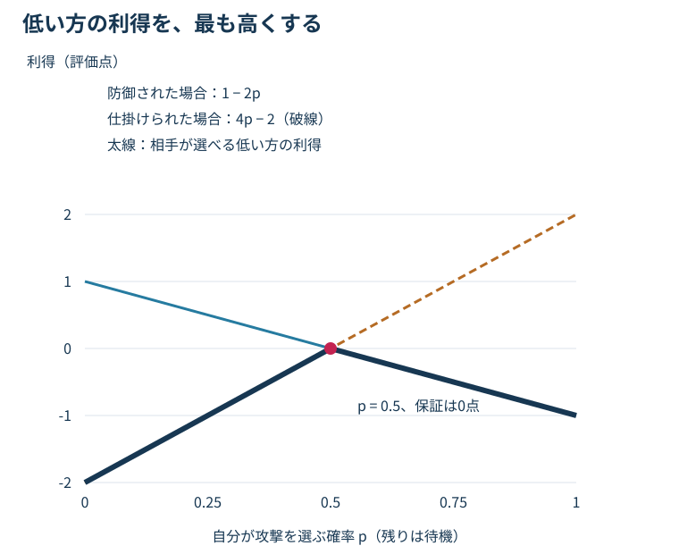

# 第6章　相手も考える：ゲーム理論と混合戦略

> **この章の結論**　固定相手に最もよく勝つ行動と、対策されても崩れにくい戦略は違います。同時行動では、複数の行動を適切な確率で混ぜること自体が最適化の対象になります。

**学習目標**：利得行列を読む／最適応答を計算する／2×2ゲームの混合比率を導く／ナッシュ均衡と相手への適応を区別する。

**前提**：期待値と一次方程式を使います。人工知能（Artificial Intelligence：AI）にゲーム理論を適用するための基礎章です。ここでの利得表は全て架空の局面評価であり、特定の技の実測勝率ではありません。

## 6.1 行動の価値は相手の選択と組になる

「攻撃すれば有利」「防御すれば安全」という文だけでは判断できません。相手が何を選ぶかで結果が変わるからです。自分に攻撃と待機、相手に防御と仕掛けの各2手がある局面を考えます。待機には交代・強化・位置取りなどの抽象的な意味を与えます。実際のポケモンの処理を再現する表ではありません。

自分から見た継続局面の価値を、@tbl-payoff-main のように置きます。数値の単位は**教材用の評価点**です。正が自分に有利、負が不利、相手はその符号を逆にした値を得るとします。

| 自分の行動 | 相手：防御 | 相手：仕掛け |
|---|---:|---:|
| 攻撃 | −1 | 2 |
| 待機 | 1 | −2 |

: 同時に行動を選ぶ架空の二人ゼロ和ゲーム。セルは自分の評価点 {#tbl-payoff-main}

相手が防御するなら待機の1が攻撃の−1よりよく、相手が仕掛けるなら攻撃の2が待機の−2よりよい。**相手に関係なく常に最良の純粋な一手はありません。** 大きい数字の2だけを見て攻撃を選ぶと、防御で対策されます。

この表は一局面を一回の選択で要約した**標準形ゲーム（normal-form game）**です。プレイヤー、戦略集合、利得関数を定めます。対戦全体の戦略は、本来は各履歴で何をするかを指定する計画です。一局面の行動と、対戦全体の戦略を混同しないよう、ここでは局所的な抽象ゲームで基礎を学びます。[1]

## 6.2 ゼロ和・定和・一般和を分ける

自分の利得を$u$、相手の利得を$v$とします。**ゼロ和**は常に$u+v=0$となる設定です。勝利を1、敗北を−1、引き分けを0として両者を対称に採点すれば、終局利得をゼロ和にできます。

両者の得点を勝利1・敗北0・引き分け0.5とすると、和は1です。これは**定和**で、各得点から0.5を引けばゼロ和になります。この変換は各自の戦略間の優劣を変えません。

**一般和**では、利得の和が結果によって変わり得ます。両者が違う途中報酬を持つ学習設定や、勝敗以外の目的を加えた評価では、ゼロ和を仮定してよいか確認します。競争的なゲームであることと、実際に使う報酬が数学的にゼロ和であることは同じではありません。

## 6.3 混合戦略と期待利得

行動を確定して選ぶのが**純粋戦略**、複数の行動に確率を割り当てるのが**混合戦略**です。ここでは自分が攻撃する確率を$p$、相手が防御する確率を$q$とします。待機は$1-p$、仕掛けは$1-q$です。いずれも0〜1です。

相手の混合比率$q$が既知なら、各純粋行動の期待利得は

$$u_{\mathrm{attack}}(q)=(-1)q+2(1-q)=2-3q,$$

$$u_{\mathrm{wait}}(q)=1q+(-2)(1-q)=3q-2.$$

添字attackは攻撃、waitは待機、$u$は期待評価点です。相手の2択で重み付けした平均を取っています。混合した自分の期待利得は

$$u(p,q)=p(2-3q)+(1-p)(3q-2).$$

たとえば$q=0.8$なら攻撃は−0.4、待機は0.4です。その相手に対しては待機を選ぶのが有利です。**読まれないために常に半々にする必要はありません。** 相手の比率が信頼でき、変化しないなら、偏りを利用する方がよい場合があります。

### 行列で書くと何が見えるか

自分の混合戦略を列ベクトル$x=(p,1-p)^\mathsf T\in\mathbb R^2$、相手の混合戦略を$y=(q,1-q)^\mathsf T\in\mathbb R^2$、自分の利得行列を$A\in\mathbb R^{2\times2}$とします。$\mathsf T$は転置、$\mathbb R$は実数、行は自分・列は相手です。

$$A=\begin{pmatrix}-1&2\\1&-2\end{pmatrix},\qquad u(x,y)=x^\mathsf T A y.$$

左から$1\times2$、$2\times2$、$2\times1$を掛けるので、結果はスカラーの評価点です。各セルの利得に、その行動対が選ばれる確率を掛けて足しています。両者が独立の私的な乱数で選ぶ仮定を置いています。共通の信号で行動を相関させる戦略は、別のモデルになります。

## 6.4 最適応答と、純粋戦略が循環する理由

相手の戦略$y$に対し、自分の期待利得を最大にする戦略の集合を**最適応答（best response）**と呼びます。

$$\operatorname{BR}(y)=\arg\max_{x\in\Delta_2}x^\mathsf T A y.$$

$\operatorname{BR}$は最適応答の集合、$\arg\max$は最大値を与える引数、$\Delta_2=\{(x_1,x_2)^\mathsf T:x_1,x_2\ge0,\ x_1+x_2=1\}$は2行動上の確率分布の集合です。同点なら最適応答は一つとは限りません。

@tbl-payoff-main で攻撃だけを選ぶ相手なら、防御だけで対策できます。それに対して自分は待機へ変え、相手は仕掛けへ変え、自分は攻撃へ戻る……という循環が起こり得ます。これは学習率やモデルサイズだけの問題とは限らず、**相互に対策する構造そのもの**から生じます。

どんな相手にも優る行動がある場合は、その行動を混ぜる必要はありません。混合戦略は「常にランダムにする」という一般的な助言ではなく、利得と相手の対応関係から導く対象です。

## 6.5 ナッシュ均衡を手で導く

**ナッシュ均衡（Nash equilibrium）**は、相手の戦略を固定したとき、どちらも自分だけ戦略を変えて利得を改善できない戦略の組です。「二人とも満足」「全員が協力」「毎回引き分け」という意味ではありません。[1]

二人ゼロ和の場合、候補$(x^*,y^*)$が均衡である条件は

$$u(x,y^*)\le u(x^*,y^*)\le u(x^*,y)\quad\text{全ての }x,y$$

です。星$*$は候補戦略の印で、累乗ではありません。左側は自分が変えても増えず、右側は相手が変えても自分の得点を減らせないことを表します。

### 自分の2手を相手が同価値にする

自分が攻撃と待機を両方正の確率で選ぶ均衡なら、相手の$q$は両者を同価値にする必要があります。

$$2-3q=3q-2\quad\Longrightarrow\quad q^*=\frac23.$$

そうでなければ、自分は価値が高い方だけを選んだ方が得だからです。ここで求めたのは**相手の比率**です。自分の2手を等しくして自分の$p$を求める、という取り違えに注意してください。

次に相手を無差別にする自分の比率を求めます。相手が防御したときの自分の利得は$1-2p$、仕掛けたときは$4p-2$です。相手は自分の利得を小さくしたいので、

$$1-2p=4p-2\quad\Longrightarrow\quad p^*=\frac12.$$

どちらの利得も0です。したがって均衡での自分の期待評価点、すなわち**ゲームの値**は0になります。

### 無差別条件だけで終わらない

求めた$p^*,q^*$が0〜1に入り、他の行動で改善できないことを確認します。この表には各2手しかないので、$q^*=2/3$に対して自分の両手は0、$p^*=1/2$に対して相手の両手は自分へ0を与えます。従って片側だけ変えても改善できません。

一般のゲームでは、無差別条件で解いた比率が範囲外になる場合、両手を混ぜる候補は成立しません。3手以上なら、正の確率で使わない手にも有利な逸脱がないか確認が必要です。方程式を解いただけで均衡と呼ばないでください。

@fig-security-envelope は、自分の攻撃確率$p$を変えたとき、相手が防御・仕掛けのどちらを選ぶかで得点が変わる様子です。2本のうち低い方が、相手に対策されたときの得点です。

{#fig-security-envelope}

図の学習目的は「最も楽観的な線ではなく、相手に選ばれる低い側を高くする」ことです。縦軸は教材の評価点で、実測勝率ではありません。

## 6.6 最悪時の保証と、平均的に勝つこと

自分がまず戦略を決め、相手がそれを知って最も厳しい戦略を選ぶと考えた値は

$$\max_{x\in\Delta_m}\min_{y\in\Delta_n}x^\mathsf T A y$$

です。$m,n$は自分と相手の行動数、$\Delta_m,\Delta_n$はそれぞれの混合戦略集合です。maxは最大、minは最小です。有限の二人ゼロ和ゲームでは、混合戦略を許すと、これが相手側から順番を逆にした$\min_y\max_x x^\mathsf T A y$と等しくなります。これが**ミニマックス定理**です。[1]

ただし、この定理を、純粋な行動だけを使う$\max_a\min_b A_{ab}$と同一視してはいけません。本例では攻撃だけなら最悪−1、待機だけなら最悪−2なので、純粋戦略での最良保証は−1です。混合なら0を保証でき、純粋戦略よりよくなります。

### 均衡は弱い相手から最大限稼ぐ戦略ではない

相手が防御を80%選び続けるなら、待機だけで0.4点です。均衡の$p=0.5$なら0点です。しかし、相手がこちらの待機を読んで仕掛けば、待機だけでは−2点になります。

つまり、相手の偏りを利用する**搾取的な適応**と、最適な対策への**頑健性**は異なる目的です。どちらがよいかは、相手の推定精度、変化の速さ、失敗への許容度に依存します。均衡戦略を使うことは、過去ログから相手を学ぶことを不要にしません。

## 6.7 不完全情報では、同じ情報から同じ判断をする

第5章の @fig-turn-information で状態と観測を分けたように、シミュレーター内部では異なる二つの状態でも、自分の履歴から区別できない場合があります。このような区別できない意思決定点の集合を**情報集合（information set）**として扱う見方があります。自分がどちらの状態にいるか知っているかのように行動を変えてはいけません。

たとえば相手の型が2種類あり、その型を見れば「攻撃」と「交代」を完全に選び分けられるとします。型を知らない現実のプレイヤーは、その分岐を直接選べません。各型で最適行動を計算してから、それらの最適値だけを平均すると、実行不可能な能力を評価してしまうことがあります。第7章でこの落とし穴を数値化します。

また、一回の表で混合戦略を選ぶ説明と、長いゲームの各情報集合で行動確率を決める**行動戦略（behavioral strategy）**は区別します。完全記憶などの仮定のもとで関連する理論がありますが、本章の2×2例だけで対戦全体の均衡を解けたことにはなりません。

## 6.8 研究へ接続する

ポケモンの公式ビデオゲーム大会（Video Game Championships：VGC）を対象とするVGC-Benchでは、方策集団や相手生成の方法を比較する研究へ接続できます。[2] 自己対戦で直前の相手に勝つことと、過去の相手を含む集団で安定することは別です。第10章で集団を使った学習を扱います。

研究を読むときは、①行列のセルが何の利得か、②対策される対象が行動か方策全体か、③相手に何を知らせるか、④方策の探索・近似にどれだけ計算を使うかを見ます。「ゲーム理論に基づく」という名称だけで、実際の対戦ゲームの厳密な均衡を得たとは言えません。

## 6.9 理解確認

問1：相手の防御率が0.2なら、攻撃・待機・半々の期待点は？

攻撃は2−3×0.2＝1.4、待機は3×0.2−2＝−1.4、半々なら0です。この固定相手には攻撃が最適応答です。均衡の混合が常に最も稼げる、という考え方は誤りです。

問2：相手の防御率を2/3にしたら、自分も攻撃率2/3にすれば均衡？

違います。相手の2/3は自分の両手を同価値にする条件です。自分が2/3攻撃すると、相手の防御による自分の利得は−1/3、仕掛けなら2/3なので、相手は防御で有利に対策できます。自分の均衡確率は1/2です。

問3：50%ずつ選ぶAIは、どのゲームでも対策されない？

され得ます。この表で自分が半々なのは数値から導いた結果で、一般則ではありません。さらに半々の実装でも、相手に次の乱数や規則性が見えれば、独立の私的乱数という前提が崩れます。

問4：均衡での期待利得が0なら、毎試合引き分ける？

いいえ。0は結果の平均です。勝敗の利得を±1とすれば、勝ち負けが半々でも平均0です。本章のセルはそもそも局面評価点で、終局勝敗への変換は定義していません。

## 6.10 まとめと一次資料

期待利得は自分と相手の戦略の組で決まります。均衡では一方だけ変えて改善できず、混合比率は相手を無差別にする条件から求められます。固定相手への高得点と、対策への保証は別です。第7章では、この区別を先読みの計算へ持ち込みます。

1. [Carnegie Mellon University：Game Theory講義ノート](https://www.cs.cmu.edu/~15281-s25/coursenotes/gametheory/index.html) — 標準形、混合戦略、最適応答、ナッシュ均衡、二人ゼロ和のミニマックスの定義。
2. [VGC-Bench公式実装](https://github.com/cameronangliss/vgc-bench) — 自己対戦・仮想プレイ・Double Oracleなどへの接続。局面の利得表と学習済み方策の対戦行列は異なる対象。本章の表・図・導出は教材独自の架空例。

