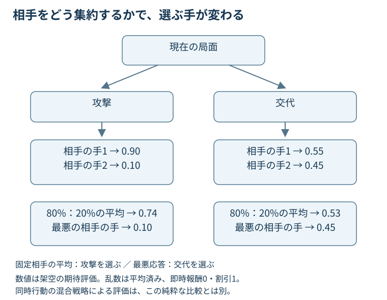

# 第7章　先を読む：探索と不完全情報

> **この章の結論**　探索は「未来をたくさん見る」だけではありません。相手の行動・乱数・隠れた情報をどう集約するかで、最適化する問いが変わります。深さや試行数を増やしても、誤った情報条件や相手モデルは直りません。

**学習目標**：相手と乱数を区別したバックアップを説明する／同時行動で純粋なミニマックスが失うものを計算する／モンテカルロ木探索の4工程と探索配分を理解する／隠れた状態ごとの最適値を平均する誤りを見抜く。

**前提**：第5章の状態・観測、第6章の期待利得と混合戦略を使います。人工知能（Artificial Intelligence：AI）の実装や疑似コードではなく、数式と小さな木で仕組みを追います。図の数値は全て教材用です。

## 7.1 探索が計算しているもの

ある局面で攻撃と交代を比べるとします。攻撃の直後に大きなダメージが入っても、次の相手の反撃で負けるかもしれません。一方、交代は直後の体力を失っても、数ターン後に有利な組合せを作るかもしれません。探索は、候補を先へ進め、行動の結果を比較するための方法です。

探索には少なくとも三つの部品が必要です。**候補を作る処理**、**行動後を生成するモデル**、**調べ終えた先を評価する処理**です。完全なシミュレーターがあっても、相手の隠れた情報が全て分かるとは限りません。逆に、よい評価関数があっても、最良の行動を候補から落とせば選べません。

探索の深さを$H$とします。ここでは両者の行動とその結果が処理される1段階を1ステップと数えます。論文によっては片側の選択だけを1 ply（半手）と呼ぶので、深さの数字だけで比較しないようにします。

## 7.2 乱数は平均、相手はモデルに応じて扱う

まず完全状態を$s$、自分の行動を$a$、相手の行動を$b$、次状態を$s'$、遷移確率を$T(s'\mid s,a,b)$、期待即時報酬を$r(s,a,b)$とします。探索の残り深さを整数$d\ge0$、割引率を$0<\gamma\le1$、残り$d$段階を見た状態価値を$V_d(s)$とします。$\gamma$は将来の評価をどれだけ重く見るかを決めます。

行動対の評価を

$$Q_d(s,a,b)=r(s,a,b)+\gamma\sum_{s'}T(s'\mid s,a,b)V_{d-1}(s')\quad(d\ge1)$$

と置きます。$Q$はその行動対を選んだ後の評価、$\sum_{s'}$は次状態全体への総和です。葉では$V_0(s)=\hat V(s)$とし、$\hat V$は打ち切った局面を採点する近似評価関数です。終局への遷移で勝敗報酬を$r$に一度だけ与える規約なら、終局後の価値は0とします。非終局の打ち切り葉に$\hat V$を使い、同じ勝敗を即時報酬と葉の価値に二重計上しません。

### 固定された相手モデルを使う

相手が行動$b$を選ぶ確率モデルを$\rho(b\mid s)$とすると、

$$V_d^{\rho}(s)=\max_a\sum_b\rho(b\mid s)Q_d^{\rho}(s,a,b).$$

上付き$\rho$は、その固定相手モデルを使って先も評価する印です。これは「この相手モデルに対して最もよい行動」を求めます。相手が実際にその分布で選ぶなら合理的ですが、モデルが外れたときの保証は別です。

### 最も厳しい応答を置く

純粋行動だけで相手の最悪応答に備えるなら

$$V_d^{\mathrm{pure}}(s)=\max_a\min_b Q_d^{\mathrm{pure}}(s,a,b)$$

と書けます。pureは純粋行動の意味です。minは「相手は自分の評価を最小にする」、maxは「その最悪値を自分が最大にする」を表します。乱数結果そのものにminを取っていないことに注意してください。命中・急所などを確率で重み付けするのか、最悪の乱数にも備えるのかは異なる評価目的です。

@fig-search-backup は、相手モデルで平均する場合と、最悪の相手行動を取る場合を比べたものです。図では割引を1、即時報酬を0とし、乱数結果は既に各セルの評価へ平均済みとします。

{#fig-search-backup}

図の攻撃は相手2手に対し0.9と0.1、交代は0.55と0.45です。相手が最初の手を80%選ぶなら、攻撃は$0.8\times0.9+0.2\times0.1=0.74$、交代は$0.8\times0.55+0.2\times0.45=0.53$。平均なら攻撃です。最悪値なら攻撃0.1、交代0.45なので交代です。異なる選択になっても、片方が計算間違いとは限りません。解いている問いが違います。

## 7.3 同時行動を交互に見せると何を仮定するか

木の上で「自分が攻撃を選ぶ→相手がその枝を見て防御を選ぶ」と描けば、相手が自分の今回の選択を知って応答するように見えます。現実の同時行動で、その情報が相手に渡るわけではありません。

完全観測・有限・二人ゼロ和の同時行動の確率ゲームを考えるなら、各状態で行動対の$Q_d$を行列に並べ、**混合戦略の行列ゲーム**として解く方法があります。自分の行動数を$m$、相手を$n$、混合戦略を$x\in\Delta_m$、$y\in\Delta_n$とします。$\Delta$は各行動の非負確率の和が1である集合です。

$$V_d(s)=\max_{x\in\Delta_m}\min_{y\in\Delta_n}x^\mathsf T Q_d(s)y.$$

ここで$Q_d(s)$は$m\times n$の利得行列、$\mathsf T$は転置です。前節の純粋なmax-minとは異なり、複数行動を混ぜられます。隠れた状態がある実際の対戦へ、この完全観測の再帰をそのまま適用できるわけではありません。まず同時行動だけの問題を切り離して学んでいます。

第6章の利得表（@tbl-payoff-main）の行列$\begin{pmatrix}-1&2\\1&-2\end{pmatrix}$なら、純粋なmax-minは−1ですが、混合では0です。自分が攻撃を半々にすれば、相手がその**混合比率**を知っても0を保証できます。相手が選択済みの実際の行動を毎回見てから応答できる設定とは、情報の与え方が違います。

「minimaxを使った」と書かれていたら、混合戦略を解いたのか、純粋行動だけを比較したのか、交互手番に近似したのかを確認します。名称だけでは分かりません。

## 7.4 モンテカルロ木探索の4工程

**モンテカルロ木探索（Monte Carlo Tree Search：MCTS）**は、全ての枝を同じ深さまで調べる代わりに、シミュレーションを繰り返し、有望または未調査の枝へ計算を配る枠組みです。[1] 「大量のランダム対戦をして平均すること」だけではありません。どの枝へ次の計算を配るかが重要です。

| 工程 | 何をするか | 注意点 |
|---|---|---|
| 選択（selection） | 既存の木をたどり、次に調べる枝を選ぶ | 現在の平均値だけでは未調査の枝を見落とす |
| 展開（expansion） | まだない候補・次局面を木に追加する | 全合法手を必ず一度に展開するとは限らない |
| 評価（simulation / evaluation） | 終局までの試行や価値関数で先を採点する | 試行方策や価値関数の偏りを引き継ぐ |
| 逆伝播（backup） | 通過した節点の回数と評価を更新する | ニューラルネットワークの勾配逆伝播とは別 |

: 木に計算を配る基本工程。相手・乱数・観測の扱いは別途設計する {#tbl-mcts-cycle}

@tbl-mcts-cycle は処理の役割を示すもので、全ての実装が同じ規則を使うという意味ではありません。選択と展開を繰り返すため、同じ木でもよく調べる部分と浅い部分ができます。最後に選ぶ行動も、途中で使う探索ボーナス最大の行動とは限りません。訪問回数などを使う設計があります。

### なぜ最も平均値が高い枝だけを選ばないのか

1回だけ試した行動が偶然よく見えたとき、その行動だけを試し続けると、他の行動の可能性を確認できません。反対に、全てを均等に試すと、明らかに弱い枝にも計算を使い続けます。よい行動を利用することと、不確かな行動を調べることの配分が必要です。

**木に対する信頼上限法（Upper Confidence bounds applied to Trees：UCT）**は、木の節点で探索と利用を配分する代表的な方法です。[2] 自分の評価を最大にする節点で、訪問済みの子候補$i$に対する説明用の形は

$$\mathrm{score}_i=\bar Q_i+c\sqrt{\frac{\ln N}{n_i}}.$$

$\bar Q_i$は候補$i$を通った試行の平均評価、$N$は親の訪問回数、$n_i>0$は候補の訪問回数、$\ln$は自然対数、$c>0$は探索の重みです。scoreは選択のための値で、期待勝率そのものではありません。未訪問の候補は別に優先して訪問するなどの規則が必要です。$c$には利得の尺度に合わせた調整が要ります。

この式は手法を理解するための一般的な表記です。原論文・実装には係数や条件の違いがあります。また、相手節点の評価の向き、乱数節点のサンプリング、同時行動の学習則は別途定めます。この一式を全節点へ同じ符号で適用しても、ポケモン向け探索にはなりません。

### 配分の手計算

親を100回訪問し、候補Aは平均0.60・25回、候補Bは平均0.50・4回、$c=0.5$とします。

$$\mathrm{score}_A=0.60+0.5\sqrt{\ln100/25}\approx0.815,$$

$$\mathrm{score}_B=0.50+0.5\sqrt{\ln100/4}\approx1.036.$$

次の調査先はBです。Bの推定値が高いからではなく、未調査性に対するボーナスが大きいからです。1を超えても確率の範囲違反ではありません。各候補以外にも親を訪れた枝があり得るため、ここで示す回数の和は親回数と一致していません。

## 7.5 隠れた状態をサンプルするときの落とし穴

隠れた持ち物を含む仮説を何種類か生成し、それぞれで完全情報の探索をする方法は、実装の出発点として分かりやすいものです。しかし、各仮説で最適に選び分けた値を平均すると、現実には持たない情報の価値を混ぜてしまう場合があります。

隠れた状態の仮説を$z$、現在の情報に基づく確率を$\beta(z)$、自分の候補$a$の期待評価を$Q(z,a)$とします。現在の情報では$z$を見分けられないので、実行可能な最良行動の値は

$$\max_a\mathbb E_{z\sim\beta}[Q(z,a)]$$

です。$\mathbb E$は期待値、$z\sim\beta$は信念分布に従う仮説の抽出です。一方、仮説ごとに最良行動を選んでから平均した

$$\mathbb E_{z\sim\beta}[\max_a Q(z,a)]$$

は「どの仮説が本当か知ってから行動できる」場合の値です。一般に

$$\max_a\mathbb E_z[Q(z,a)]\le\mathbb E_z[\max_a Q(z,a)]$$

です。右辺の方が条件に応じて柔軟に選べるためです。

| 隠れた状態 | 事前確率 | 攻撃の評価 | 交代の評価 |
|---|---:|---:|---:|
| 型1 | 0.5 | 1 | 0 |
| 型2 | 0.5 | 0 | 1 |

: 今回の判断では型を観測できない架空例 {#tbl-hidden-choice}

@tbl-hidden-choice では、攻撃も交代も平均0.5で、混ぜても0.5です。ところが型ごとに最適値1を取って平均すれば1になります。これは計算量不足ではなく、**利用できない情報を使った過大評価**です。将来の観測で型を識別できるなら、その後の行動を分けることはできます。いま同じ情報しかない段階の行動を分けることが問題です。

不完全情報ゲームで、異なる隠れた世界の戦略を実行不可能な形で融合させる問題は**戦略融合（strategy fusion）**と呼ばれます。[3] 一回の決定では行動を固定して各仮説の価値を平均すればこの例の問題を避けられますが、深い木の将来分岐でも情報条件を保つ必要があります。

### 信念と観測履歴に基づく木

**部分観測モンテカルロ計画（Partially Observable Monte-Carlo Planning：POMCP）**は、部分観測の計画で信念のサンプリングと木探索を組み合わせる方法です。[4] 現在の信念から状態をサンプルし、行動・観測の履歴に基づいて探索する考え方が、単一の隠れた状態を真実と決め打ちする方法との重要な違いです。

ただし、これは固定環境の部分観測意思決定を扱う基礎研究です。相手も学習・適応する同時行動ゲームの均衡を、そのまま解くものではありません。相手モデルを固定するのか、戦略的な相手を別に扱うのかを確認します。

## 7.6 より深い探索が必ず強いとは限らない

探索の誤りは、少なくとも次の原因に分かれます。

| 原因 | 何が起こるか | 確認したい比較 |
|---|---|---|
| 候補の欠落 | よい技・対象・交代を一度も調べない | 候補数と重要行動の被覆 |
| 遷移モデルの誤り | 先読みした結果がルールと違う | 固定局面でのシミュレーター照合 |
| 相手モデルの誤り | 起こらない相手行動へ最適化する | 相手分布を変えた頑健性 |
| 葉の価値の偏り | 深い先の局面を誤って高評価する | 深さ・評価関数の切り分け |
| 情報条件の違反 | 知らない型を知る前提で選ぶ | 観測履歴と分岐の整合 |
| 試行の不足 | 平均評価のノイズが大きい | 同じ時間予算での反復評価 |

: 探索回数を増やすだけでは解決しない誤り {#tbl-search-errors}

@tbl-search-errors の最初の五つは、試行回数を増やすだけでは消えない場合があります。深くしたことで、誤ったモデルや評価をより強く信じることもあります。時間予算、モデルへの問い合わせ回数、対戦試合数、相手を固定しながら比較して初めて、探索の効果を議論できます。

ダブルでは味方2体の結合行動と相手の結合行動を組み合わせます。各側64候補なら行動対は4096、2段階を全展開すれば行動対だけで$4096^2=16,777,216$通りです。これは乱数分岐を無視した粗い上限的な増加例で、合法性や終局・枝共有による削減も無視しています。実測の計算量ではありません。候補削減・価値関数・サンプリングが研究対象になる理由を示します。

## 7.7 論文への入口：ポケモンで探索を使う

### 情報集合の探索を適用した先行研究

Iharaほか（2018）は、情報集合に基づくモンテカルロ木探索をポケモンへ適用・評価した研究です。[6] 戦略融合という理論上の問題を、ポケモンのシミュレーターでどう検証するかを見る入口になります。当時の実験条件での比較を、現在のルールやVGCダブルでの優位性へ直接広げないようにします。

### PokéChampでは探索の部品を確認する

PokéChampは、大規模言語モデル（Large Language Model：LLM）を、行動候補の生成、相手モデル、状態価値の推定へ使い、ミニマックス型の探索と組み合わせる研究です。[5] 本章で分けた三つの部品に対応させると、言語モデルが探索全体のどこを担うのかを読みやすくなります。

同研究の対象である第9世代のOverUsed（OU：対戦フォーマット名）は、VGCダブルと同一条件ではありません。各モジュールの設計を学ぶことと、報告された成績を自分のダブル環境へ移すことを分けてください。本章では性能数値の横並び比較を行いません。

読む順番は、まず探索の木で自分・相手・確率をどう扱うか、次に候補をどのように絞るか、最後に価値推定と推論予算が結果に与える影響です。手法名より、情報条件と計算配分を先に確認します。

## 7.8 理解確認

問1：相手の行動確率が分からないから、乱数の結果も全て最悪を取れば通常の期待勝率を最大化できる？

一般にはできません。戦略的に選ぶ相手と、ルールに従う確率的な結果は別です。乱数も最悪化するなら、期待値と違う頑健性の目的になります。意図した目的なら可能ですが、通常の期待勝率と呼ばないようにします。

問2：信頼上限のスコアが1.036なら、勝率103.6%という不正な値？

違います。平均評価に探索ボーナスを足した調査先選択用のスコアです。確率として使う量ではありません。最終行動の選択規則や報告する勝率とは区別します。

問3：型1なら攻撃、型2なら交代で必ず評価1。型が不明でも期待値1？

いいえ。同じ情報から型ごとに選び分けることはできません。本文の例では、今回選べる攻撃・交代の期待値はいずれも0.5です。将来の情報獲得と、現在使えない情報を区別します。

問4：第6章の行列を純粋なmax-minで解くと−1、混合で解くと0。どちらも同じ同時行動問題の厳密解？

同じではありません。純粋戦略に制限するか、相手が自分の実現した選択を見て応答する近似では−1になります。非公開の私的乱数で混合でき、相手がその実現値を事前に見ない同時行動では0を保証できます。

問5：探索を2倍深くしたAIが強くなった。探索アルゴリズムだけの改善を示した？

計算時間や問い合わせ回数も増えていれば、それだけでは言えません。同じ時間予算での比較と、深さ・候補数・評価関数を固定した比較が違う問いに答えます。改善自体と原因の特定を分けます。

## 7.9 まとめと一次資料

探索では、乱数の期待値、相手モデルの平均、最悪応答を分けます。同時行動の混合戦略と、相手に手を見せる純粋な木は同じではありません。モンテカルロ木探索は試行の配分を工夫しますが、情報条件とモデルの誤りまで自動修正しません。次の第8章では、データから方策を学ぶ模倣学習へ進みます（未執筆）。

1. [Browneほか：A Survey of Monte Carlo Tree Search Methods](https://repository.essex.ac.uk/4117/) — 探索の基本工程と拡張の概観。
2. [Kocsis & Szepesvári：Bandit Based Monte-Carlo Planning](https://aima.cs.berkeley.edu/~russell/classes/cs294/s11/readings/Kocsis%2BSzepesvari%3A2006.pdf) — 木の探索と利用の配分の基礎論文。保証の仮定と、実対戦への適用は区別。
3. [Cowling, Powley & Whitehouse：Information Set Monte Carlo Tree Search](https://eprints.whiterose.ac.uk/id/eprint/75048/) — 情報集合と、決定化・戦略融合の問題への入口。
4. [Silver & Veness：Monte-Carlo Planning in Large POMDPs](https://proceedings.neurips.cc/paper/2010/hash/edfbe1afcf9246bb0d40eb4d8027d90f-Abstract.html) — 信念のサンプリングと部分観測下の計画。
5. [Karten, Nguyen & Jin：PokéChamp](https://proceedings.mlr.press/v267/karten25a.html) — 言語モデルによる候補生成・相手モデル・価値推定を探索へ組み込むポケモン研究。本章の利得表・探索数・スコア例は同論文の実験結果ではない。

6. [Iharaほか：Implementation and Evaluation of Information Set Monte Carlo Tree Search for Pokémon](https://eprints.lib.hokudai.ac.jp/repo/huscap/all/72345/) — 2018年のポケモンへの適用研究。リンク先は著者最終稿と書誌情報。
