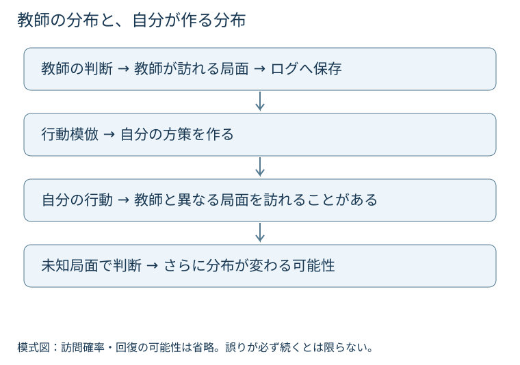

# 第8章　模倣学習：行動を学ぶことと勝つこと

> **結論**　人間の対戦ログから行動を予測するモデルは、強い初期方策になり得ます。ただし、行動一致率と対戦性能は別です。自分で行動したときに訪れる局面の変化まで考える必要があります。

**学習目標**：行動模倣の目的関数を読む／合法手と結合行動の表現を説明する／分布のずれを計算例で理解する／模倣から強化学習へ移る理由と限界を整理する。

## 8.1 なぜ人間の行動から始めるのか

全く無作為に行動する方策では、連携が必要な局面へ到達するだけでも多くの試合を要する場合があります。人間のログには、よく使われる技・交代・組合せが含まれています。それを教師として、判断の出発点を作るのが**行動模倣（Behavior Cloning：BC）**です。

これは、教師の行動を正解ラベルとする教師あり学習です。教師が各局面で本当に最善手を選んだと証明するものではありません。勝った試合の全ての行動が最善だったとも限りません。相手の失敗や乱数で勝った試合にも、悪い判断は混ざり得ます。

同じ局面に複数の有効な行動がある点も重要です。教師と違う行動が全て誤りとは限りませんし、教師と一致しても相手に読まれるなら対戦で不利になることがあります。

## 8.2 何を入力し、何を正解にするか

判断時点まで利用できる履歴を$h$、教師が選んだ合法行動を$a$とします。パラメータを$\theta$、方策を$\pi_\theta(a\mid h)$と書きます。$\pi$は合法行動上の確率分布で、各値は非負、合計1です。履歴には自分から見えた観測と行動を入れ、教師ログに保存されている未来の情報や相手の非公開情報を混ぜません。

ダブルでは一つの教師ラベルが、味方2体の技・対象・交代を含む**結合行動**になり得ます。技だけ正しく対象を誤る場合と、完全に一致する場合を分けて採点する必要があります。

各枠を別々に出力するなら、独立な確率の積にする設計と、先に選んだ枠に条件付ける設計は違います。前者は単純ですが、連携や枠間の合法性を十分に表現できない場合があります。後者も、順番や合法手マスクの作り方を確認する必要があります。マスクは選べない候補を除く仕組みであり、相手の隠れた情報を使う口実ではありません。

| 判断する対象 | 教師ラベルの例 | 見落としやすいこと |
|---|---|---|
| 技 | 技の種類 | 対象や交代を含まない |
| 1枠の行動 | 技と対象、または交代先 | 他方の枠との連携 |
| 結合行動 | 2枠をまとめた選択 | 候補数と合法性制約 |

: 同じ行動一致率でも、正解ラベルの単位が異なる {#tbl-bc-label}

@tbl-bc-label のどれを使ったかが分からない論文同士では、一致率をそのまま比較できません。

## 8.3 尤度を最大にするという意味

教師データを$\mathcal D=\{(h_i,a_i)\}_{i=1}^N$とします。$N$は局面数、添字$i$は局面番号です。負の対数尤度の平均を損失とすると、

$$L_{\mathrm{BC}}(\theta)=-\frac1N\sum_{i=1}^N\log\pi_\theta(a_i\mid h_i).$$

$L$は小さくしたい損失、添字BCは行動模倣、$\log$は自然対数です。教師が実際に選んだ行動へ高い確率を置くほど、その局面の損失は小さくなります。確率0なら損失は発散するので、数値計算では安定した対数確率を使います。

たとえば同じ教師行動に確率0.8を与えるモデルの損失は$-\log0.8\approx0.223$、0.2なら約1.609です。二つの局面へそれぞれ0.8、0.2を与えた平均は約0.916です。この値は勝率ではありません。

### 同じ正解率でも損失は違う

2択の教師行動がどちらの局面でも攻撃だとします。モデルAが各局面で攻撃確率0.51、モデルBが0.99なら、最大確率の行動を選ぶ一致率はどちらも100%です。しかし平均損失はAが約0.673、Bが約0.010です。損失は予測分布の確信度にも反応します。

ただし、Bが対戦で必ず強いとは言えません。教師の判断が悪い場合や、相手に偏りを利用される場合もあります。損失、一致率、実際に確率で行動を抽出したときの勝率は、それぞれ別の量です。

## 8.4 ログの分布と、自分が作る分布

教師が訪れる履歴の分布を$d^{\mathrm E}$、学習方策が自分で対戦して訪れる分布を$d^{\pi_\theta}$とします。Eはexpert（教師）の印です。通常の行動模倣は主に前者で損失を小さくしますが、対戦で必要なのは後者での判断です。

$$\mathbb E_{h\sim d^{\mathrm E}}[\ell(h)]\qquad\text{と}\qquad\mathbb E_{h\sim d^{\pi_\theta}}[\ell(h)]$$

$\ell(h)$は局面ごとの損失、$\mathbb E$は期待値、$\sim$はその分布から選ぶことです。二つの分布が違えば、左でよいことは右でよいことを保証しません。自分の交代ミスで教師がほとんど経験しない不利な局面へ進むと、その後にも誤りが続く可能性があります。[1]

{#fig-bc-distribution}

@fig-bc-distribution の目的は、予測が次の入力分布を変えることを示す点です。色は優劣の数値を表しません。実際の訪問確率や誤りの回復は省略しています。

### 誤りの蓄積の手計算

各判断で教師と異なる確率が0.02で、それらが独立だという**架空の単純モデル**を考えます。50回連続で一度も違わない確率は

$$(1-0.02)^{50}=0.98^{50}\approx0.364.$$

1回の一致率98%でも、50回を通した完全一致は約36.4%です。ただし、これは勝率の計算ではありません。異なる行動が有効な場合も、誤りから回復する場合もあります。実対戦では誤りの独立性も通常保証されません。

理論では、教師分布上の局所誤りが長期の損失へ増幅される例が構成できます。[1] それを「全ての対戦で損失が必ず二乗で増える」という経験則へ読み替えないでください。

## 8.5 自分の訪問局面にも教師を付ける

**データ集約（Dataset Aggregation：DAgger）**は、学習方策が訪れる局面にも教師の判断を問い合わせ、データを集約して方策を学び直す考え方です。[1] 教師が普段うまく避ける局面を、自分が訪れたならそこで何をすべきかも学べます。

ただし、過去ログだけでは、その未知局面の教師ラベルは自動的には得られません。人間への追加問い合わせや、判断できる教師モデルが必要です。対戦結果から学ぶ強化学習とは、教師信号の出どころが異なります。

ポケモンの公式ビデオゲーム大会（Video Game Championships：VGC）を対象とするVGC-Benchには、人間ログからの行動模倣と、その後の対戦経験による学習を扱う資産があります。[2] これを「DAggerを実行している」と読み替えず、何を教師として更新する実装かを確認します。

## 8.6 データを増やす前に、何を確認するか

同じ試合の両視点や隣接ターンを訓練とテストへ分けると、未知試合への適用を測れない可能性があります。チーム・対戦者・時期が共通なら、どこまでを未知にした評価かも限定されます。第2章のデータ分割を、ここでは教師信号の品質にも適用します。

勝者だけを残すと、強い判断が増える可能性はありますが、勝因と無関係な行動も残ります。また、負け側が不利な局面でどう耐えるかという例が減ります。高レートだけを使う方法にも、量・多様性・ルールの偏りとの交換条件があります。

ログから復元した行動が、実際にその時点で合法か、対象の番号が正しいか、公開情報だけで復元されているかを確認します。ラベルがずれていれば、高性能な学習器でも誤りを忠実に学びます。

## 8.7 模倣から強化学習へ

模倣で初期方策を作ると、無作為な初期化より意味のある局面を経験しやすくなる可能性があります。しかし、初期方策への依存、未知のチーム、教師の癖、追加計算の費用を残します。

比較では、模倣の直後と強化学習後を同じ相手・同じチーム条件で評価します。一致率が下がって勝率が上がる場合もあれば、報酬は増えて固定評価の勝率が下がる場合もあります。模倣損失の低下だけで、その後の改善を説明できません。

次章の**近接方策最適化（Proximal Policy Optimization：PPO）**は、教師行動との一致ではなく、対戦経験と報酬から方策を更新する方法です。BCとPPOの比較では、更新式だけでなく、教師データと対戦経験の両方の資源を数えます。

## 8.8 理解確認

問1：教師行動の確率が0.5から0.8へ上がった。損失と勝率はどうなる？

その局面の負の対数尤度は約0.693から0.223へ下がります。勝率の変化は、この情報だけでは分かりません。教師との一致と勝利への価値を混同しないでください。

問2：ログ上の一致率が高いのに、自分で対戦すると失敗が続く原因は？

自分の行動が作る履歴の分布と、教師ログの分布が異なる可能性があります。他にもラベル復元・観測の互換性・行動実行の不具合が考えられます。分布のずれと決めつけず、失敗局面を確認します。

問3：過去ログを2倍集めれば、自分が訪れる未知局面への教師ラベルも得られる？

保証されません。過去ログは教師が訪れた分布の例です。自分固有の失敗局面を含むとは限りません。DAggerでは、そのような局面への教師問い合わせが重要になります。

問4：各枠で技が一致したから、結合行動も完全正解？

対象・交代先・枠間の合法性が異なる可能性があります。評価単位を定義する必要があります。独立な各枠の予測精度だけでは連携も測れません。

## 8.9 まとめと一次資料

模倣は、教師の行動分布を学ぶ出発点です。目的関数を小さくすること、ログ上で一致すること、自分で対戦して勝つことを区別します。履歴の分布とデータ分割を確認したうえで、次章では結果から方策を改善します。

1. [Ross, Gordon & Bagnell（2011）：A Reduction of Imitation Learning and Structured Prediction to No-Regret Online Learning](https://proceedings.mlr.press/v15/ross11a.html) — 逐次判断における分布のずれとDAggerの基礎。
2. [VGC-Bench公式実装](https://github.com/cameronangliss/vgc-bench) — 人間ログの処理、行動模倣、学習済み方策への接続。実装の版を固定して読む。

本章の確率・損失・連続一致の数値は教材用で、論文の実測値ではありません。
