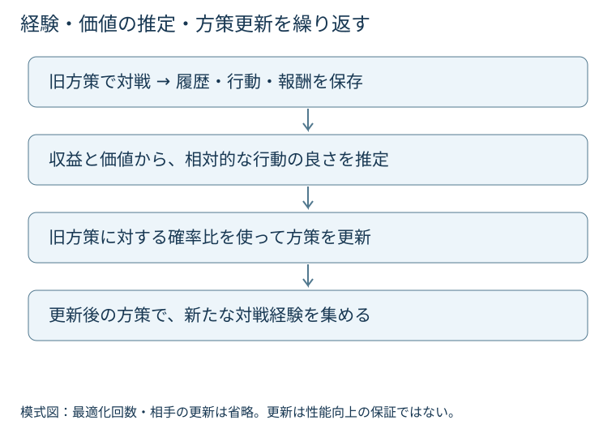

# 第9章　強化学習：価値から方策の更新へ

> **結論**　強化学習は、選んだ行動の結果から将来の報酬を改善します。価値は将来の見積もり、アドバンテージは行動の相対的な良さです。近接方策最適化は、この推定を使いながら大きすぎる更新の誘因を抑えますが、性能向上を無条件に保証しません。

**学習目標**：収益・状態価値・行動価値を計算する／時間差分誤差とアドバンテージを区別する／方策勾配の向きを理解する／クリッピングの符号別の挙動を計算する。

**読み方**：重い章なので、9A（9.1〜9.4：価値）と9B（9.5〜9.9：方策更新）の2レッスンに分けます。線形代数・微分の復習やコードは省略します。初歩の用語はこの章で定義します。

## 9.1 9A：何を最大にするのか

**強化学習（Reinforcement Learning：RL）**では、経験した報酬から行動規則である方策を改善します。判断時刻を$t$、その時の状態を$s_t$、自分の行動を$a_t$、遷移後に得る報酬を$r_{t+1}$、終了時刻を$T$、割引率を$0<\gamma\le1$とします。将来の割引報酬和、すなわち**収益（return）**を

$$G_t=\sum_{k=0}^{T-t-1}\gamma^k r_{t+k+1}$$

と定義します。$k$は今から何ステップ後かを数える整数です。報酬と収益は、定義した評価点の単位を持ちます。終了後の収益は0とします。

報酬が順に0、0、1なら、最初の収益は$\gamma^2$です。割引率0.9なら0.81、1なら1。終局で勝ちを1・それ以外を0にして割引しなければ、期待収益は勝利確率です。割引すると、同じ勝利でも到達の速さで重みが変わります。引き分けや敗北をどう採点するかでも目的は変わります。

### 相手を固定するという前提

以下の基本式は、相手方策を固定し、環境の一部へ組み込んだマルコフ決定過程（Markov Decision Process：MDP）を想定します。環境の分布が学習中も同じという基準モデルです。実際の対戦で相手が更新される場合、この前提から外れます。

部分観測では、状態の代わりに利用可能な履歴や信念を考えます。現在の観測だけの価値推定は、その履歴依存性を近似しているかもしれません。式が書けることと、入力が十分な情報を持つことは別です。

## 9.2 状態価値・行動価値・アドバンテージ

方策を$\pi(a\mid s)$とします。これは状態$s$から合法行動$a$を選ぶ確率です。**状態価値**を$V^\pi(s)$、最初の行動まで固定した**行動価値**を$Q^\pi(s,a)$とすると、

$$V^\pi(s)=\mathbb E_\pi[G_t\mid s_t=s],\qquad Q^\pi(s,a)=\mathbb E_\pi[G_t\mid s_t=s,a_t=a].$$

$\mathbb E_\pi$は、以後は方策$\pi$に従い、環境の確率も含めた期待値です。$V$と$Q$はスカラーの評価点で、確率そのものとは限りません。以後の行動選択も含むので、今の技のダメージ量とは違います。

行動価値が方策の平均からどれだけよいかを表す**アドバンテージ（advantage）**を

$$A^\pi(s,a)=Q^\pi(s,a)-V^\pi(s)$$

とします。$A$は行動の相対的な評価で、正にも負にもなります。これは第6章の利得行列と同じ文字ですが、この章ではスカラーのアドバンテージとして定義します。

2行動の行動価値が攻撃0.8・交代0.4で、方策が攻撃を25%選ぶなら、

$$V^\pi(s)=0.25\times0.8+0.75\times0.4=0.5.$$

アドバンテージは攻撃0.3・交代−0.1です。方策に従う平均は$0.25\times0.3+0.75\times(-0.1)=0$になります。交代の価値0.4が正でも、現在の平均より劣るのでアドバンテージは負です。

## 9.3 ベルマン方程式は、未来を一段に分ける

遷移確率を$P(s'\mid s,a)$、期待即時報酬を$R(s,a)$とします。$s'$は次状態です。方策の価値は、

$$Q^\pi(s,a)=R(s,a)+\gamma\sum_{s'}P(s'\mid s,a)V^\pi(s'),$$

$$V^\pi(s)=\sum_a\pi(a\mid s)Q^\pi(s,a)$$

を満たします。これが固定方策の**ベルマン期待方程式**です。次の価値と今の報酬を足し、それを行動確率で平均しています。全ての状態・行動を既知として計算できると仮定した関係式で、実際の学習では一部を試行から推定します。

状態価値の真値$V^\pi$ではなく、推定器$V_\phi$を使うとします。$\phi$は価値推定のパラメータです。一回の遷移から作る**時間差分誤差（Temporal-Difference error：TD誤差）**は

$$\delta_t=r_{t+1}+\gamma V_\phi(s_{t+1})-V_\phi(s_t).$$

$\delta$はギリシャ文字デルタで、目標と現在の見積もりの差です。終局への遷移では次状態の価値を0とします。時間制限による打ち切りと、ゲームの真の終局は区別し、適切に次の価値を扱う必要があります。

報酬0.1、割引率0.9、次状態価値0.7、現在価値0.5なら、目標は0.73、誤差は0.23です。推定が低かったことを示しますが、一回の正の誤差だけで「この行動が最善」とは言えません。環境の乱数と価値推定誤差が混ざるからです。

## 9.4 実際の経験から相対的な良さを推定する

終局まで待った収益から現在価値を引く方法は、先の報酬を観測できますが、長い対戦ではばらつきが大きくなる場合があります。短い時間差分だけを使うと、価値推定の誤差へ依存します。

**一般化アドバンテージ推定（Generalized Advantage Estimation：GAE）**は、時間差分誤差を複数ステップにわたり重み付けする方法です。[2] 重みのパラメータを$0\le\lambda\le1$とし、取得済み区間の終わりを$H$とすると、

$$\hat A_t=\sum_{l=0}^{H-t-1}(\gamma\lambda)^l\delta_{t+l}.$$

帽子$\hat{\ }$は推定値、$l$は先のステップ数、$H$はこのデータ区間の終端です。真の終局前に区間を切るなら、最後のTD誤差に次状態価値を含めます。終局をまたいで別試合の誤差を足してはいけません。

誤差が0.2、−0.1の2項、$\gamma=0.9,\lambda=0.8$なら$\hat A_t=0.2+0.72(-0.1)=0.128$です。正でも、真のアドバンテージが正である保証ではありません。推定の偏り・ばらつきと、相手が変わることの影響を分けます。

ここで9Aを区切れます。収益・価値・相対評価の違いを説明できてから、次の更新式へ進んでください。

## 9.5 9B：方策勾配は、どの方向へ動くか

パラメータ$\theta$の方策$\pi_\theta$での期待収益を$J(\theta)$とします。固定環境・固定初期分布に対する有限長の軌跡を$\tau$、その確率を$p_\theta(\tau)$とすると、尤度比の恒等式から

$$\nabla_\theta J=\mathbb E_{\tau\sim p_\theta}[G_0\nabla_\theta\log p_\theta(\tau)]$$

と書けます。$\nabla_\theta$はパラメータについての勾配です。環境の遷移に$\theta$が入らなければ、対数軌跡確率の勾配は選んだ行動の対数方策確率の勾配の和になります。

直感的には、よい結果を出した行動の確率を増やす方向です。ただし全試合の結果を全行動へ同じように帰属するとノイズが大きいため、その時点以後の収益や、状態だけに依存する基準値を引いた相対評価を使います。基準値が行動に依存しないなら、適切な期待値のもとで方策勾配を変えず、ばらつきを減らす余地があります。[1]

実装でよく使う推定形は、旧方策で集めたデータの各時刻に対して、$\nabla_\theta\log\pi_\theta(a_t\mid h_t)\hat A_t$を平均するものです。$h_t$は利用可能な履歴です。割引・時刻の重み、データ分布、アドバンテージの推定を省いたこの説明だけを、任意の目的関数の厳密な勾配式とは呼びません。

## 9.6 近接方策最適化のクリッピング

**近接方策最適化（Proximal Policy Optimization：PPO）**の代表的な方式では、旧方策のデータを使い、更新の誘因をクリッピングした代理目的を最大化します。[3] 旧パラメータを$\theta_{\mathrm{old}}$とし、旧方策で実際に選んだ行動の確率比を

$$r_t(\theta)=\frac{\pi_\theta(a_t\mid h_t)}{\pi_{\theta_{\mathrm{old}}}(a_t\mid h_t)}$$

とします。ここで$r_t$は報酬ではなく確率比です（報酬は本章では$r_{t+1}$と表記）。分母は正である必要があります。行動表現と合法手マスクも新旧で整合させます。

クリップ幅を$\epsilon>0$、推定アドバンテージを固定値$\hat A_t$として、

$$L^{\mathrm{clip}}(\theta)=\hat{\mathbb E}_t\left[\min\left(r_t(\theta)\hat A_t,\operatorname{clip}(r_t(\theta),1-\epsilon,1+\epsilon)\hat A_t\right)\right].$$

$\hat{\mathbb E}_t$は取得データ上の平均、$\operatorname{clip}(x,l,u)$は$x$を下限$l$と上限$u$に挟む処理、minは小さい方です。これは**最大化**する代理目的です。損失を最小化する実装では符号を逆にします。

### 正と負で、止める方向が違う

$\epsilon=0.2$とします。確率比1.5・アドバンテージ2なら、未クリップは3、クリップ側は2.4なので、採用する値は2.4です。この標本では、よい行動の確率を既に大きく増やした先に、さらに利益を与えません。

確率比0.5・アドバンテージ−2なら、未クリップは−1、クリップ側は−1.6で、minは−1.6です。悪い行動の確率を十分減らした先の改善を頭打ちにします。

逆に、よい行動の確率を減らす、悪い行動の確率を増やす方向には、不利な値を残します。**比を常に範囲内へ強制する制約ではありません。** パラメータを共有する他の標本の更新で、比が範囲外になることもあります。

| アドバンテージ | 確率比 | 未クリップ項 | 採用される項 |
|---|---:|---:|---:|
| 2 | 1.5 | 3.0 | 2.4 |
| −2 | 0.5 | −1.0 | −1.6 |
| 2 | 0.5 | 1.0 | 1.0 |
| −2 | 1.5 | −3.0 | −3.0 |

: クリップ幅0.2での標本別代理目的。利得単位は推定アドバンテージに従う {#tbl-ppo-sign}

@tbl-ppo-sign を使い、確率をどちらへ変えたとき頭打ちになるかを確認してください。代理目的の改善は、新しい相手・未知チームでの勝率改善を保証しません。

## 9.7 学習は、価値の推定と方策の改善を往復する

{#fig-rl-update}

@fig-rl-update は、固定したデータを無期限に使い続ける学習ではない点を示します。各工程の最適化回数、データ量、相手の更新は省略しています。

方策を更新する**アクター（actor）**と、価値を推定する**クリティック（critic）**を組み合わせる構成があります。価値推定の損失は方策の代理目的とは別です。探索のためのエントロピー項を加える場合もありますが、エントロピーが高いこと自体が対戦の強さではありません。

PPOは主に現在に近い方策で集めた経験を使う方法です。旧ログを長く使うと確率比のずれや推定の問題が増えます。模倣に使った人間ログを、そのまま最新方策の経験として扱わないでください。

## 9.8 行動模倣から移るときに読むべきもの

前章の行動模倣（Behavior Cloning：BC）で初期化し、PPOで更新するなら、初期方策の強さ、報酬設計、学習相手、合法手の扱い、固定評価の5点を確認します。初期方策が人間らしくても、報酬の抜け道や特定相手への過適合で崩れる場合があります。

ポケモンの公式ビデオゲーム大会（Video Game Championships：VGC）を対象とするVGC-Benchの実装では、更新方法と相手生成の方法を分けて読みます。[4] PPOを使うことは、相手集団の循環や未知チームへの汎化まで解決することを意味しません。

比較すべきなのは「訓練中の報酬」だけではありません。固定した対戦条件での勝率と不確かさ、複数の学習実行、対戦ログ、代表リプレイを対応付けます。損失がきれいに下がることは、競技上の改善の証拠の代わりになりません。

## 9.9 理解確認

問1：報酬0、0、1を割引率0.5で得た。最初の収益は？

0＋0.5×0＋0.5²×1＝0.25です。割引を使うと、終局の勝利報酬1と最初の収益は同じではありません。

問2：行動価値0.4が正なのにアドバンテージが負なのは矛盾？

矛盾しません。状態価値が0.5ならアドバンテージは−0.1です。行動価値の絶対値ではなく、現在の方策の平均との差を表します。

問3：報酬0.1、次価値0.7、現在価値0.5、割引率0.9の時間差分誤差は？

0.1＋0.9×0.7−0.5＝0.23です。推定値に対して上振れした1標本であり、真の価値誤差や最善行動の証明ではありません。

問4：幅0.2、確率比1.5、アドバンテージ−2では、比を1.2に置き換えればよい？

未クリップ項−3とクリップ項−2.4の小さい方、−3を採用します。常にクリップ側だけを使うと式の意味が変わります。負のアドバンテージでは符号を確認してください。

問5：PPOの比が範囲内に見えたので、全局面の方策差と勝率改善が保証された？

されません。標本上の代理目的であり、全局面の分布差を拘束する硬い制約ではありません。相手分布や推定誤差も残ります。独立した対戦評価が必要です。

## 9.10 まとめと一次資料

収益は将来報酬の和、価値はその期待値、アドバンテージは行動の相対評価です。方策更新には、推定の信頼性と新旧データの分布が影響します。次の第10章では、更新する方策だけでなく、対戦相手をどう作るかを扱います（未執筆）。

1. [Sutton & Barto：Reinforcement Learning: An Introduction](http://incompleteideas.net/book/the-book-2nd.html) — 収益、ベルマン方程式、時間差分学習、方策勾配の基礎。
2. [Schulmanほか：High-Dimensional Continuous Control Using Generalized Advantage Estimation](https://arxiv.org/abs/1506.02438) — 相対評価推定の重み付けと偏り・分散の扱い。
3. [Schulmanほか：Proximal Policy Optimization Algorithms](https://arxiv.org/abs/1707.06347) — クリップした代理目的と実験。原論文の実験をポケモンでの保証へ移さない。
4. [VGC-Bench公式実装](https://github.com/cameronangliss/vgc-bench) — 行動模倣による初期化と対戦学習の接続。

本章の数値例と図は教材独自の説明であり、学習実験の成績ではありません。
